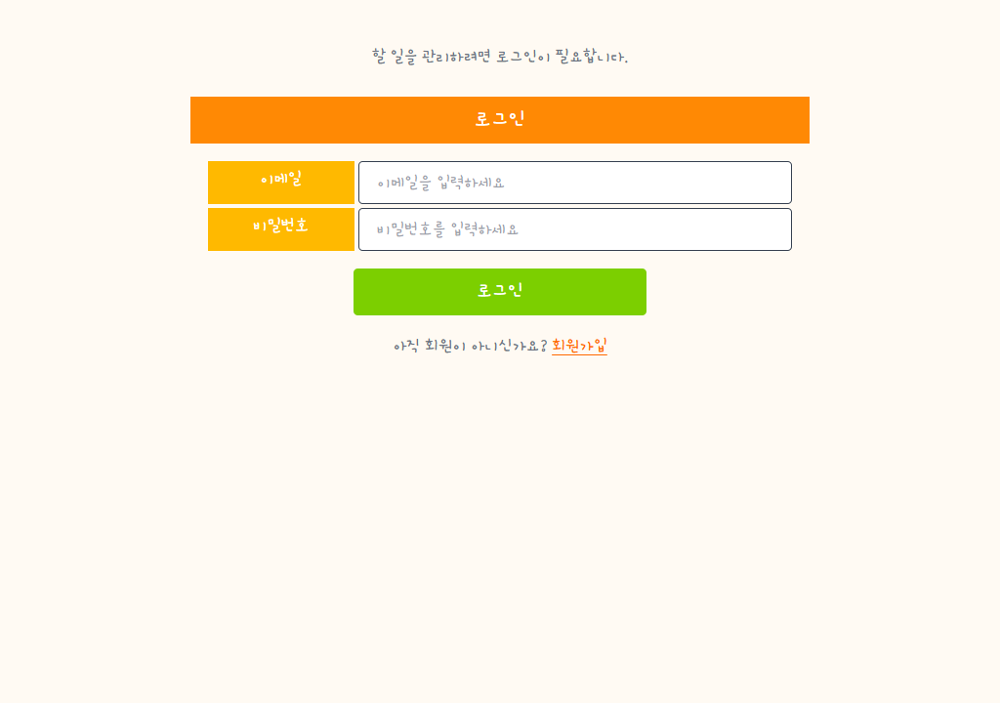
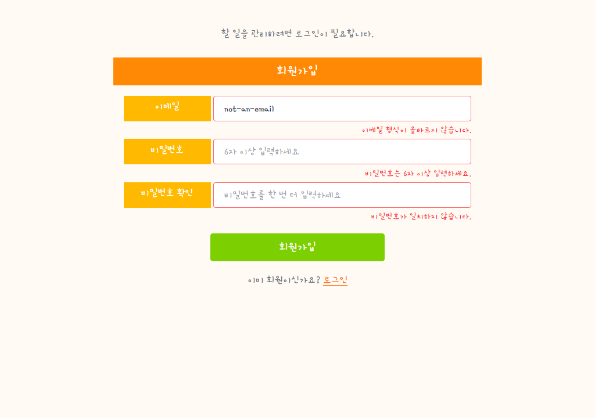
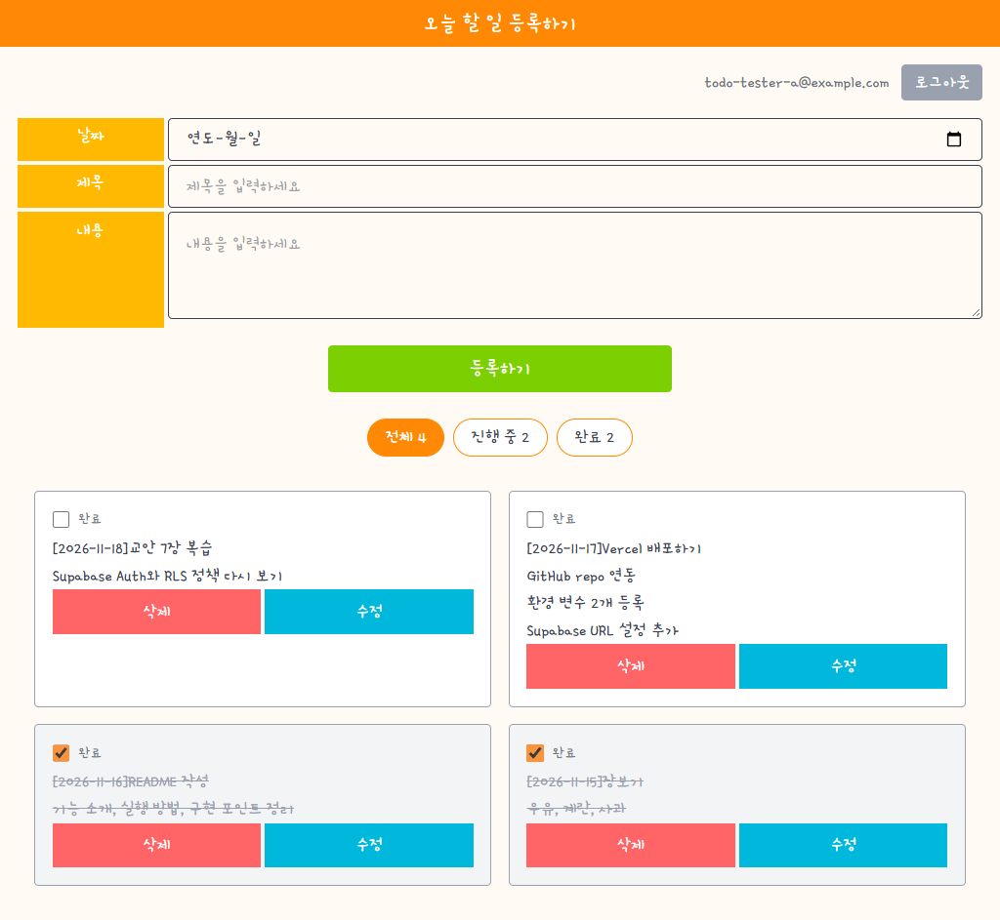
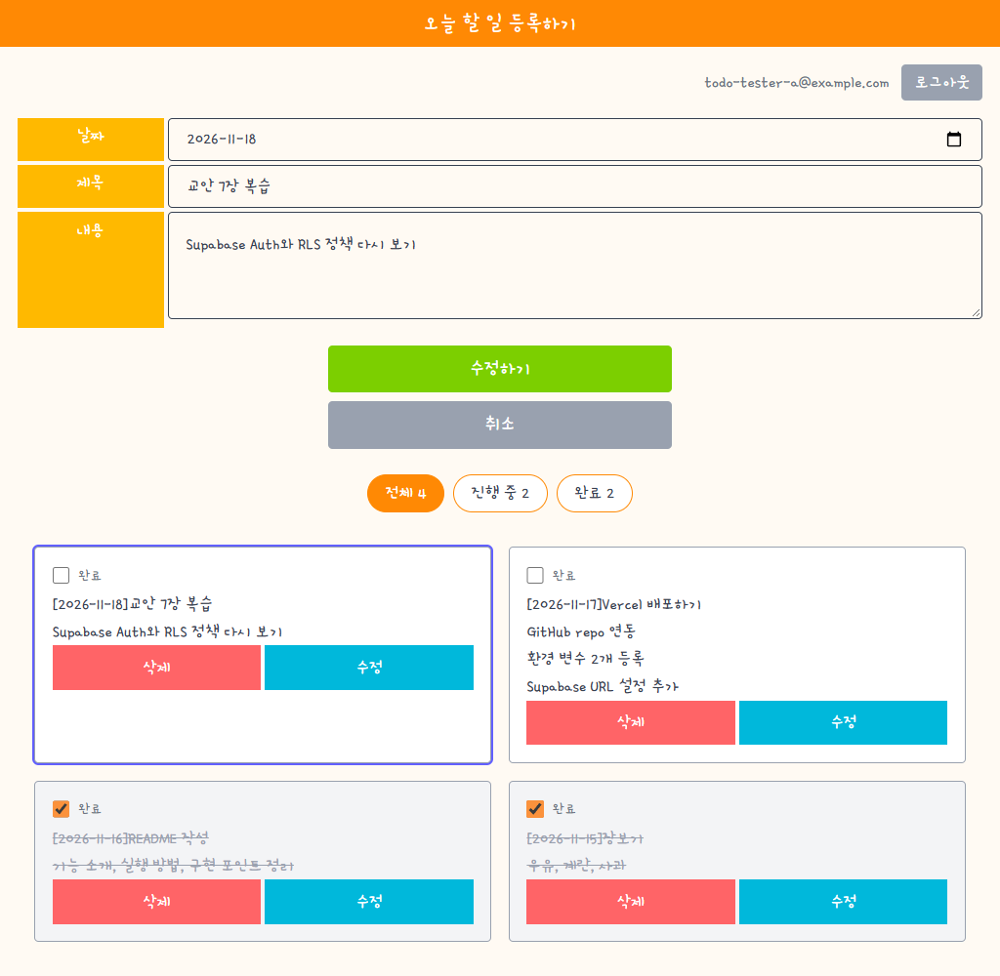
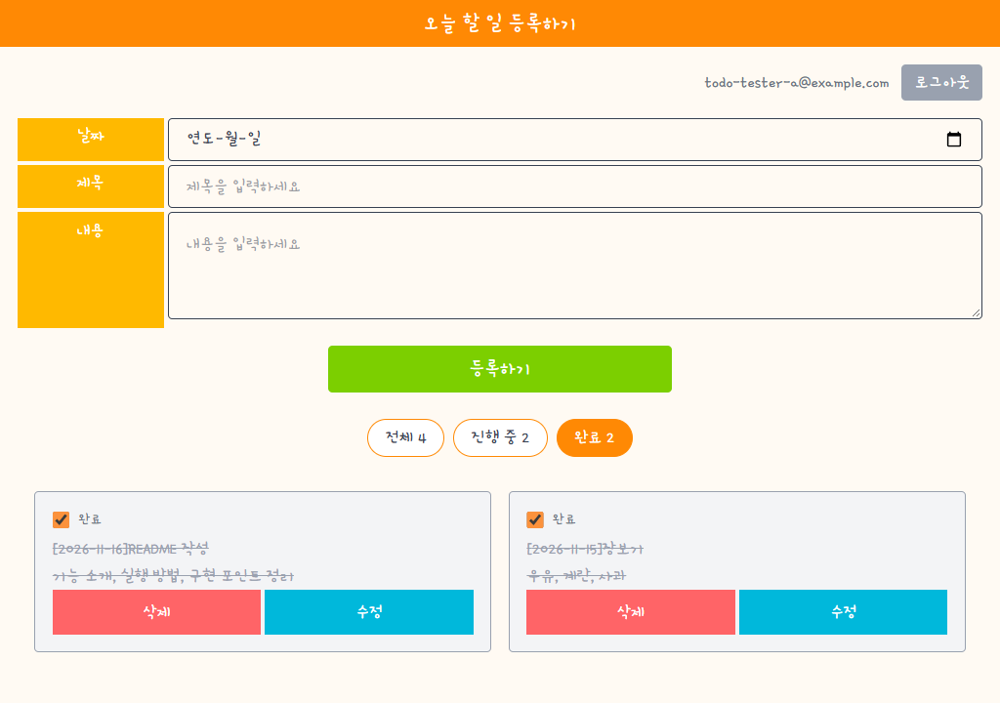
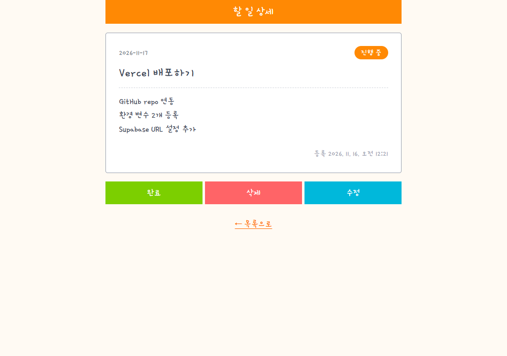
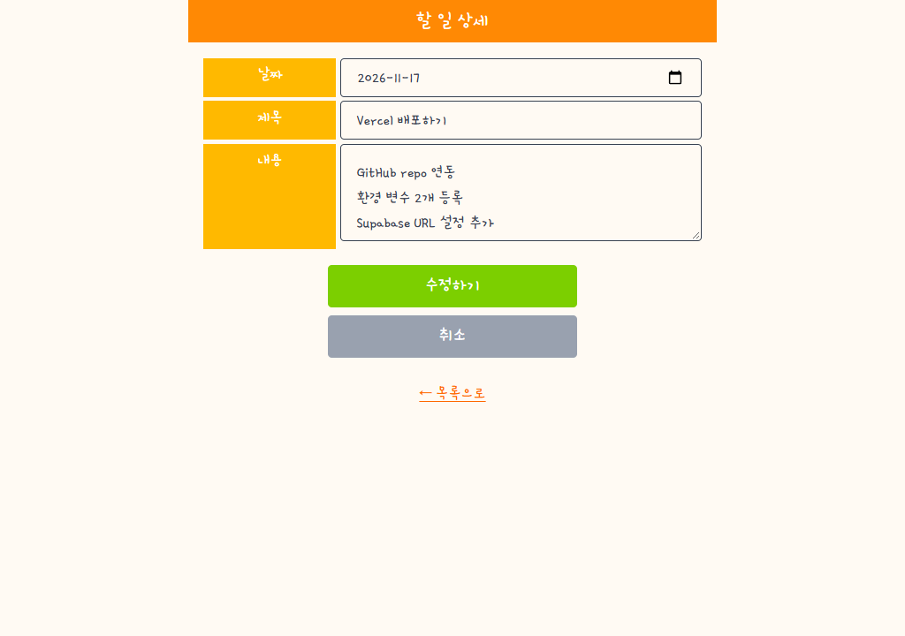
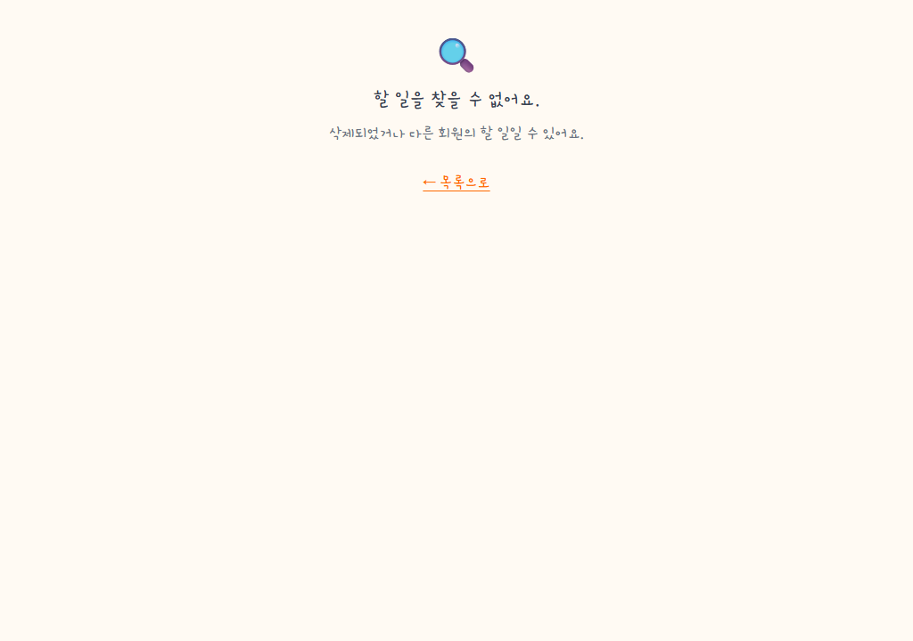

# 📝 Next.js Todo 리스트

이전에 순수 JavaScript로 만든 [Todo 리스트](https://github.com/jsa00/JavaScript-Todo-List)를 **Next.js + Supabase**로 옮긴 회원 전용 할 일 관리 앱입니다.
회원가입·로그인한 사용자만 들어올 수 있고, 할 일은 Supabase DB에 저장되어 **내 할 일만** 등록·조회·수정·삭제할 수 있습니다.

> KANT 프론트엔드 응용 (React/Next.js) 과제 — Todo 리스트 Next.js 전환 및 고도화

<br>

## 🔗 링크

| 구분 | 주소 |
| --- | --- |
| 배포 주소 | 배포 후 추가 예정 |
| 이전 버전 (JavaScript) | [jsa00/JavaScript-Todo-List](https://github.com/jsa00/JavaScript-Todo-List) |

<br>

## ✨ 주요 기능

| 기능 | 설명 |
| --- | --- |
| 회원가입·로그인·로그아웃 | Supabase Auth 이메일·비밀번호 인증, 입력칸별 오류 문구 표시 |
| 회원 전용 화면 | 로그인하지 않으면 로그인 페이지로 이동, 로그인 후 원래 가려던 페이지로 복귀 |
| 등록 | 날짜·제목·내용을 입력해 할 일 추가, 빈 칸이면 안내창 표시 |
| 수정 | 목록에서는 양식에 기존 값을 채워 수정, 상세 페이지에서는 그 자리에서 수정 폼으로 전환 |
| 삭제 | 확인창에서 확인하면 삭제 |
| 완료 체크·필터 | 체크박스로 완료 전환, 전체 / 진행 중 / 완료 필터와 필터별 개수 표시 |
| 상세 페이지 | 목록에서 제목을 누르면 `/todos/번호` 상세 페이지로 이동 |
| 상태별 화면 | 불러오는 중 / 목록 / 오류 / 빈 목록 / 없는 할 일 화면을 각각 표시 |

<br>

## 📸 페이지별 화면

### 1. 로그인 · 회원가입 (`/login`, `/signup`)

| 로그인 | 회원가입 입력값 검사 |
| :---: | :---: |
|  |  |

- 로그인하지 않고 다른 페이지에 들어가면 로그인 페이지로 이동하고, 로그인하면 원래 가려던 페이지로 돌아갑니다.
- 이메일 형식, 비밀번호 6자 이상, 비밀번호 확인 일치 여부를 입력칸마다 안내합니다.

### 2. 할 일 목록 (`/`)



- 상단에 접속한 계정과 로그아웃 버튼이 표시됩니다.
- 완료한 할 일은 취소선과 회색 배경으로 표시되고, 필터 버튼에 필터별 개수가 나옵니다.

| 목록에서 수정 | 완료 필터 |
| :---: | :---: |
|  |  |

- 수정 버튼을 누르면 양식에 기존 값이 채워지고, 수정 중인 카드가 테두리로 강조됩니다.

### 3. 할 일 상세 (`/todos/[id]`)

| 상세 보기 | 상세 페이지 안에서 수정 |
| :---: | :---: |
|  |  |

- 목록에서 제목을 누르면 상세 페이지로 이동합니다.
- 수정 버튼을 누르면 페이지를 벗어나지 않고 그 자리에서 수정 폼으로 바뀌고, 저장하면 바로 반영됩니다.

### 4. 없는 할 일



- 없는 번호, 숫자가 아닌 주소, 다른 회원의 할 일 주소로 들어오면 표시됩니다.

<br>

## 🛠 기술 스택

| 구분 | 사용 기술 |
| --- | --- |
| 프레임워크 | Next.js 16.4 (App Router, Cache Components, Turbopack), React 19.3 |
| 언어 | TypeScript 5 |
| 스타일 | Tailwind CSS v4 + `app/globals.css` 공통 스타일, `next/font` Gamja Flower |
| 백엔드 (BaaS) | Supabase — Auth, PostgreSQL, RLS |
| 연동 | `@supabase/ssr`, `@supabase/supabase-js` |
| 배포 | Vercel |
| 코드 품질 | ESLint, Prettier |

<br>

## 📁 파일 구조

```
Next.js-Todo-List
├── app
│   ├── (auth)                    # 로그인·회원가입 라우트 그룹 (주소에는 붙지 않음)
│   │   ├── login/page.tsx        # /login
│   │   ├── signup/page.tsx       # /signup
│   │   ├── layout.tsx            # 인증 화면 공통 레이아웃
│   │   └── actions.ts            # login · signup · logout Server Actions
│   ├── todos/[id]                # 할 일 상세 동적 라우트 (/todos/번호)
│   │   ├── page.tsx              # 상세 조회 (서버 컴포넌트)
│   │   ├── loading.tsx           # 불러오는 중
│   │   ├── not-found.tsx         # 없는 할 일·다른 회원의 할 일
│   │   └── error.tsx             # 조회 오류 (다시 시도)
│   ├── components
│   │   ├── TodoList.tsx          # 목록 조회 (서버)
│   │   ├── TodoBoard.tsx         # 필터·수정 모드 상태 관리 (클라이언트)
│   │   ├── TodoForm.tsx          # 등록·수정 공용 폼
│   │   ├── TodoFilters.tsx       # 전체 / 진행 중 / 완료 필터 버튼
│   │   ├── TodoItem.tsx          # 할 일 카드
│   │   ├── TodoDetail.tsx        # 상세 보기 ↔ 수정 전환
│   │   ├── TodoDetailActions.tsx # 상세 페이지 완료·삭제·수정 버튼
│   │   ├── AuthForm.tsx          # 로그인·회원가입 공용 폼
│   │   └── UserProfile.tsx       # 접속 계정, 로그아웃 (서버)
│   ├── queries/todos.ts          # 할 일 조회 함수 (getTodos, getTodoById)
│   ├── types                     # Todo, 액션 결과 타입
│   ├── utils                     # 필터 설정, 입력값 검사
│   ├── actions.ts                # saveTodo · toggleTodo · deleteTodo Server Actions
│   ├── page.tsx                  # 메인 (할 일 목록)
│   ├── layout.tsx                # 루트 레이아웃, 글꼴
│   └── globals.css               # Tailwind + 공통 스타일
├── utils/supabase
│   ├── server.ts                 # 서버 컴포넌트·Server Actions용 Supabase 클라이언트
│   └── proxy.ts                  # 세션 쿠키 갱신, 로그인 여부에 따른 이동
├── proxy.ts                      # 라우트 가드 진입점 (Next.js 16의 proxy, 이전 이름 middleware)
├── sql                           # Supabase SQL Editor에서 순서대로 실행
│   ├── 01_create_todos.sql
│   ├── 02_add_todo_fields.sql
│   └── 03_auth_rls.sql
├── docs/img                      # README 페이지별 스크린샷
└── .env.example                  # 환경 변수 예시
```

<br>

## ▶️ 실행 방법

### 1. 패키지 설치

```bash
npm install
```

### 2. 환경 변수

`.env.example`을 복사해 `.env`를 만들고, Supabase 대시보드 **Project Settings > API**의 값을 넣습니다.

```bash
NEXT_PUBLIC_SUPABASE_URL=https://프로젝트ID.supabase.co
NEXT_PUBLIC_SUPABASE_PUBLISHABLE_KEY=sb_publishable_...
```

### 3. DB 테이블 만들기

Supabase 대시보드 **SQL Editor**에서 `sql` 폴더의 파일을 **번호 순서대로, 파일 전체를 선택해** 실행합니다.

| 순서 | 파일 | 내용 |
| --- | --- | --- |
| 1 | `01_create_todos.sql` | `todos` 테이블 생성 |
| 2 | `02_add_todo_fields.sql` | `date`·`content` 컬럼 추가 |
| 3 | `03_auth_rls.sql` | `user_id` 컬럼 추가, RLS 켜기, 본인 데이터만 접근하는 정책 |

### 4. 개발 서버 실행

```bash
npm run dev
```

브라우저에서 `http://localhost:3000` 접속 → 로그인 페이지로 이동하면 정상입니다.

<br>

## 🗄 DB 구조

### todos (할 일)

| 컬럼 | 타입 | 제약조건 | 설명 |
| --- | --- | --- | --- |
| id | BIGINT | **PK**, IDENTITY | 할 일 번호 |
| created_at | TIMESTAMPTZ | NOT NULL, DEFAULT now() | 등록 일시 |
| date | DATE | NOT NULL, DEFAULT current_date | 할 일 날짜 |
| title | TEXT | NOT NULL | 제목 |
| content | TEXT | NOT NULL, DEFAULT '' | 내용 |
| is_completed | BOOLEAN | NOT NULL, DEFAULT false | 완료 여부 |
| user_id | UUID | NOT NULL, DEFAULT auth.uid(), **FK → auth.users(id)** ON DELETE CASCADE | 작성자 |

### RLS 정책

로그인한 사용자(`authenticated`)만 접근할 수 있고, 모든 정책이 `auth.uid() = user_id` 조건으로 **본인 데이터만** 허용합니다.

| 동작 | 정책 |
| --- | --- |
| SELECT | 본인 할 일만 조회 |
| INSERT | 본인 UID로만 등록 (`user_id`는 DB 기본값 `auth.uid()`로 채워짐) |
| UPDATE | 본인 할 일만 수정, 작성자를 다른 사람으로 바꿀 수 없음 |
| DELETE | 본인 할 일만 삭제 |

비로그인(`anon`) 권한은 회수해서, publishable key만으로는 테이블을 읽을 수 없습니다.

<br>

## 💡 구현 포인트

### 과제 기준별 구현 내용

| 과제 기준 | 구현 내용 |
| --- | --- |
| **[필수] 컴포넌트 분리·Props** | 목록(`TodoList` → `TodoBoard` → `TodoForm` · `TodoFilters` · `TodoItem`)과 상세(`TodoDetail` → `TodoDetailActions`)를 기능 단위로 나누고, 모든 Props에 `interface`로 타입 지정 |
| **[필수] 사용자 인증·회원 전용 화면** | Supabase Auth 회원가입·로그인·로그아웃, `proxy.ts` 라우트 가드, RLS로 회원별 데이터 분리 |
| **[필수] Hook 상태 제어·데이터 연동** | 아래 Hook 표 참고. Server Action 실행 후 `revalidatePath`로 서버 데이터를 다시 받아 화면에 바로 반영 |
| **[필수] 상태별 UI** | 아래 상태별 화면 표 참고 |
| **[필수] 페이지 라우팅** | 파일 기반 라우팅(`/`, `/login`, `/signup`), 동적 라우트(`/todos/[id]`), 라우트 그룹(`(auth)`) |
| **[심화] 컴포넌트 설계·Hook 규칙** | 등록·수정 폼 하나를 목록과 상세에서 재사용, 필터 설정을 데이터로 분리, `useEffect` 의존성 배열에 들어가는 함수는 `useCallback`으로 고정 |
| **[심화] 렌더링 방식 최적화** | 아래 서버/클라이언트 컴포넌트 표 참고 |

### 서버 컴포넌트 / 클라이언트 컴포넌트 구분

**DB 조회는 서버에서 끝내고, 클릭·입력처럼 브라우저 상태가 필요한 부분만 클라이언트 컴포넌트**로 만들었습니다.

| 컴포넌트 | 종류 | 이유 |
| --- | --- | --- |
| `page.tsx` (목록·상세) | 서버 | 제목 바 같은 고정 부분은 미리 렌더링(Partial Prerender), DB가 필요한 부분만 `Suspense`로 스트리밍 |
| `TodoList`, `UserProfile` | 서버 | Supabase 조회를 서버에서 끝내서 브라우저가 따로 데이터를 요청하지 않고, 첫 화면 HTML에 데이터가 담겨 옴 |
| `TodoBoard` | 클라이언트 | 선택한 필터, 수정 중인 할 일 같은 화면 상태 관리 |
| `TodoForm`, `AuthForm` | 클라이언트 | `useActionState`로 Server Action 결과·진행 상태 표시 |
| `TodoItem`, `TodoDetailActions` | 클라이언트 | 체크박스·버튼 클릭, 확인창 |
| `TodoDetail` | 클라이언트 | 보기 ↔ 수정 전환. 내용 카드는 서버에서 그린 것을 `children`으로 받아 클라이언트 번들에 들어가지 않음 |

```
page.tsx (서버)
 ├─ 제목 바 ················ 빌드 때 미리 렌더링
 ├─ <Suspense> UserProfile (서버) ··· 요청 때 스트리밍
 └─ <Suspense> TodoList (서버, DB 조회)
                └─ TodoBoard (클라이언트, 필터·수정 상태)
                     ├─ TodoForm · TodoFilters
                     └─ TodoItem × N
```

### 데이터 흐름

```
사용자 입력 / 클릭
   → Server Action (saveTodo · toggleTodo · deleteTodo)   서버에서 Supabase에 저장
   → revalidatePath('/'), revalidatePath('/todos/번호')   해당 페이지 캐시 비우기
   → 서버 컴포넌트가 최신 데이터로 다시 렌더링
```

JavaScript 버전의 "변경 → 저장 → 다시 그리기" 흐름을 그대로 유지하되, 저장소가 `localStorage`에서 Supabase로, 다시 그리기가 `render()`에서 서버 컴포넌트 재렌더링으로 바뀌었습니다.

### React Hook 활용

| Hook | 위치 | 하는 일 |
| --- | --- | --- |
| `useState` | `TodoBoard`, `TodoDetail` | 선택한 필터, 수정 중인 할 일, 보기·수정 모드 |
| `useActionState` | `TodoForm`, `AuthForm` | Server Action 결과(성공·오류 문구)와 진행 상태(`isPending`) |
| `useTransition` | `TodoItem`, `TodoDetailActions` | 완료 토글·삭제가 끝날 때까지 버튼 잠금 |
| `useEffect` | `TodoForm` | 저장 결과에 따라 안내창 표시·등록 모드 복귀, 수정 모드가 되면 폼으로 스크롤 |
| `useCallback` | `TodoBoard`, `TodoDetail` | `TodoForm`의 `useEffect` 의존성인 함수를 고정해 effect가 반복 실행되지 않게 함 |
| `useRef` | `TodoForm` | 폼 스크롤, 제목 입력칸 포커스 |
| `useRouter` | `TodoDetailActions` | 삭제 후 `router.replace('/')`로 삭제된 페이지가 방문 기록에 남지 않게 이동 |
| `useSearchParams` | `AuthForm` | 로그인 후 돌아갈 주소(`redirectUrl`) 읽기 |

### 상태별 화면

| 상태 | 목록 (`/`) | 상세 (`/todos/[id]`) |
| --- | --- | --- |
| 불러오는 중 | `Suspense` fallback "할 일을 불러오는 중..." | `loading.tsx` |
| 성공 | 할 일 카드 목록 (`key={todo.id}`) | 할 일 상세 카드 |
| 오류 | `TodoList`에서 오류 문구 표시 | `error.tsx` (다시 시도 버튼) |
| 빈 데이터 | 필터마다 다른 안내 문구 | `not-found.tsx` (없는 번호·다른 회원의 할 일) |

### 인증과 보안

| 단계 | 하는 일 |
| --- | --- |
| `proxy.ts` | 모든 페이지 요청 전에 세션 쿠키를 갱신하고, 비로그인이면 `/login?redirectUrl=원래주소`로, 로그인 상태에서 `/login`·`/signup`이면 `/`로 이동 |
| Server Actions | 입력값 검사(빈 칸, 이메일 형식, 비밀번호 6자 이상·확인), 로그인 후 이동 주소는 `/`로 시작하는 내부 경로만 허용 |
| RLS | 실제 데이터 접근 권한은 DB가 검사. 다른 회원의 할 일 주소로 들어가도 조회 결과가 비어 "찾을 수 없어요"가 표시됨 |

`proxy`는 화면 이동만 막는 1차 검사이고, 데이터는 RLS가 최종으로 막습니다.

### JavaScript 버전에서 바뀐 점

| 항목 | JavaScript 버전 | Next.js 버전 |
| --- | --- | --- |
| 저장소 | `localStorage` (브라우저마다 따로) | Supabase DB (회원별, 어디서나 같은 데이터) |
| 사용자 | 없음 | 회원가입·로그인, 회원별 데이터 분리 |
| 화면 그리기 | `todo` 객체의 `render()`가 `innerHTML`로 갱신 | 컴포넌트 + 상태, 서버 컴포넌트 재렌더링 |
| 이벤트 처리 | 부모 요소에 이벤트 위임 | React 이벤트 Props (`onClick`, `onChange`) |
| XSS 방지 | `escapeHtml()`로 직접 치환 | React가 출력 값을 자동 이스케이프 |
| 템플릿 | `<script type="text/html">` + `${이름}` 치환 | JSX 컴포넌트 |
| 페이지 | 한 페이지 | 목록, 상세(`/todos/[id]`), 로그인, 회원가입 |
| 글꼴 | Google Fonts CDN | `next/font` (빌드 때 내려받아 같은 도메인에서 제공) |

필터 설정(`match`·`empty`), 필수 입력 안내 문구, 화면 디자인(`style.css`)은 이전 버전 것을 그대로 옮겼습니다.

<br>

## 📌 작업 기록

이슈 → 브랜치 → PR 순서로 작업했습니다.

| PR | 작업 |
| --- | --- |
| [#2](https://github.com/jsa00/Next.js-Todo-List/pull/2) | Next.js 16 프로젝트 초기 세팅, Supabase 패키지 설치 |
| [#4](https://github.com/jsa00/Next.js-Todo-List/pull/4) | Supabase `todos` CRUD 연동, JavaScript Todo 화면·기능 이전 |
| [#6](https://github.com/jsa00/Next.js-Todo-List/pull/6) | Supabase Auth 회원가입·로그인, RLS 회원 전용 Todo |
| [#8](https://github.com/jsa00/Next.js-Todo-List/pull/8) | 할 일 상세 페이지 동적 라우트 (`/todos/[id]`) |
